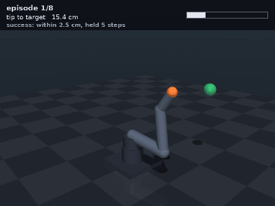
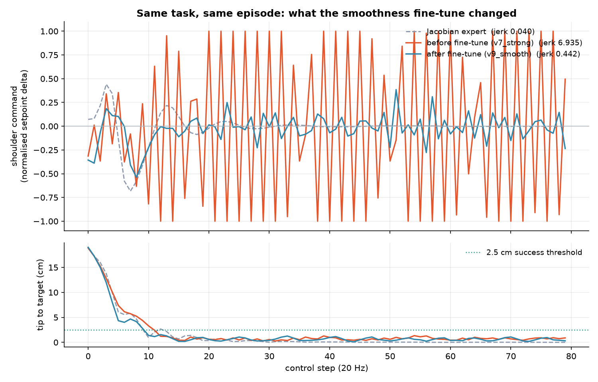

# Servo arm in MuJoCo: target reaching with reinforcement learning

Simulation stage of a 4-degree-of-freedom (4-DOF) hobby-servo arm (3× MG996R + 1× SG90): the arm is modelled from scratch in MuJoCo, wrapped as a Gymnasium environment, trained with Proximal Policy Optimization (PPO) to reach targets under domain randomisation, and compared against a scripted Jacobian controller. The physical arm has not been built yet.



*Evaluation episodes of the shipped policy, with domain randomisation active. The top band shows the tip-to-target distance and reads "SETTLED" when the tip stays within 2.5 cm for 5 control steps. Full video: [`media/rollout.mp4`](media/rollout.mp4).*

## Problem / context

For the Embedded Systems course (Universidad ECCI, Bogotá, 2026) I will build a servo arm and mount it on my line-following robot, with the task of picking up cubes and stacking them. The arm will use three MG996R servos and one SG90, driven by a microcontroller. **The arm does not exist yet: it has not been printed or assembled.** Every result in this repository comes from simulation.

Before making parts and writing firmware, this repository answers questions that are expensive to answer on hardware:

- Can the servos hold the arm in its worst posture, and with how much margin?
- How fast can each joint move, and what position error does gravity leave?
- Can a controller be learned that reaches the target and stays there, without chattering the gears, even when mass, friction, sensor noise and latency differ from the model?
- How does it compare with a classical (Jacobian) controller that learns nothing?

This stage covers only **reaching** (bringing the tip to a point). Grasping and stacking cubes are still to be done (see "What is missing").

## How it works

### Architecture

```
models/arm.xml               MJCF model of the arm: bodies, joints, position actuators, sensors
models/reach_scene.xml       Task scene (includes arm.xml unchanged) and floating target
servoarm/reach_env.py        Gymnasium environment: spaces, reward, domain randomisation
tests/validate_physics.py    Physics checks run before any training
tests/scripted_expert.py     Reference Jacobian controller and reward audit
tests/plot_smoothness.py     Plot of the command before and after the smoothness fine-tune
train/train_ppo.py           PPO training: 9 reward variants and warm start from a previous policy
train/evaluate.py            Evaluation against the Jacobian expert and against "do nothing"
train/render_rollout.py      Video with overlaid telemetry
runs/finetune_smooth/        Shipped policy, normalisation statistics and its evaluation
runs/study/                  JSON summaries of every run in the reward study
docs/                        Technical notes: physics debugging and reward evolution
```

MuJoCo (Multi-Joint dynamics with Contact) is the simulator; MJCF is its XML model format. PPO is the reinforcement learning algorithm, taken from Stable-Baselines3.

### Arm model

| joint | servo | range | stall torque (actuator limit) | speed (datasheet) |
|---|---|---|---|---|
| base (yaw) | MG996R | ±90° | 0.98 N·m (10 kgf·cm at 6 V) | 0.17 s / 60° = 6.16 rad/s |
| shoulder | MG996R | −0.35 to 2.10 rad | 0.98 N·m | 6.16 rad/s |
| elbow | MG996R | −2.40 to 0.20 rad | 0.98 N·m | 6.16 rad/s |
| wrist (pitch) | SG90 | ±90° | 0.18 N·m (1.8 kgf·cm at 4.8 V) | 0.10 s / 60° = 10.47 rad/s |

Links of 100 mm (upper arm), 100 mm (forearm) and 50 mm (wrist). MuJoCo computes masses and inertias from the geometry and an assumed density of 1180 kg/m³ (cast acrylic). Each servo is modelled as a position actuator with finite proportional and derivative gains, viscous damping, Coulomb friction and reflected rotor inertia (armature). Fourth-order Runge-Kutta integrator (RK4) with a 2 ms step; control at 20 Hz (25 physics steps per control step).

What comes from where:

| quantity | source |
|---|---|
| stall torque, speed | servo datasheets |
| link lengths, material density | design assumptions |
| damping, armature, friction, actuator gains | estimates, to be identified on the physical arm |

### Learning environment

| element | definition |
|---|---|
| observation (21) | normalised joint positions (4), velocities (4), tip position (3), target position (3), target − tip (3), previous action (4). No absolute time, so the policy holds position instead of learning the episode clock |
| action (4) | **change** in each servo setpoint in [−1, 1], scaled to what the servo can travel in a 50 ms period at its datasheet speed: 17.6° for the MG996R, 30° for the SG90 |
| reward | potential-based shaping `γφ(s′) − φ(s)` with `φ = −distance` (Ng et al., 1999), a bonus inside the tolerance, and penalties on command magnitude, command change between steps and joint velocity. `γ = 0.99`, same as PPO |
| success | tip within **2.5 cm** of the target for **5 consecutive control steps** (a settled arrival, not a fly-through) |
| episode | 4 s (80 control steps) |
| targets | a joint configuration is sampled and its forward kinematics taken, so every target is reachable by construction |

PPO parameters: 8 parallel environments, 256 steps per environment per update, batch size 256, 10 epochs, `gae_lambda` 0.95 (generalised advantage estimation), clip 0.2, entropy coefficient 0.004, multilayer perceptron of 2 × 128 units for the policy and another for the value function, observations normalised with `VecNormalize` (reward not normalised, so variants stay comparable).

### Decisions that prepare the transfer to hardware

| decision in simulation | what it represents on the planned arm | where |
|---|---|---|
| actuator force limit = datasheet stall torque | a servo cannot deliver more than its stall torque; if the model allowed it, the policy would learn impossible motions | `models/arm.xml` (`forcerange`) |
| action = setpoint change limited by servo speed | a command the servo cannot execute in 50 ms cannot even be expressed | `SLEW_RAD_S` and `max_delta` in `servoarm/reach_env.py` |
| position actuator with finite gain | as in a hobby servo, the setpoint is not the actual angle: gravity leaves a steady-state error | `models/arm.xml`, `tests/validate_physics.py` |
| observation noise: 0.004 rad on position, 0.02 rad/s on velocity | an assumed position reading of about 10 bits over 180° | `DomainRandCfg` |
| latency of 0 to 1 control steps (0 to 50 ms) | assumed delay between microcontroller and servo | `DomainRandCfg` |
| domain randomisation: mass ±15 %, damping ±30 %, armature ±20 %, servo gain ±20 % | uncertainty in part mass, gear grease that changes with temperature, unit-to-unit servo variation and supply sag; the widths are design assumptions | `DomainRandCfg` |
| evaluation with ranges 2× wider than in training (mass ±30 %, damping ±60 %, armature and gain ±40 %, double noise, latency up to 100 ms) | the closest available proxy for the sim-to-real gap without the arm | `train/evaluate.py` |
| command-smoothness penalty and fine-tune | a command that swings end to end works in simulation and wears real gears | `v9_smooth_finetune` in `train/train_ppo.py` |
| rest pose chosen for minimum load on the most loaded servo | the arm should be able to stand still without heating a servo | `home` keyframe in `models/arm.xml` |

## Results and measurements

Everything in this section is **simulated**. Nothing has been measured on a physical arm, because it has not been built yet.

### Evaluation of the shipped policy

Source: [`runs/finetune_smooth/evaluation.json`](runs/finetune_smooth/evaluation.json), produced by `train/evaluate.py`. 150 episodes per condition, deterministic policy. The Jacobian expert is a damped least-squares controller that does not learn; "do nothing" is the floor.

| agent | condition | success | mean final distance | 90th percentile final distance | command jerk | mean peak torque |
|---|---|---|---|---|---|---|
| policy | nominal (no randomisation) | 0.58 | 6.4 cm | 22.0 cm | 0.391 | 0.92 N·m |
| policy | training randomisation | **0.61** | 6.2 cm | 22.1 cm | 0.316 | 0.91 N·m |
| policy | 2× wider randomisation | **0.42** | 7.2 cm | 22.0 cm | 0.356 | 0.91 N·m |
| Jacobian expert | nominal | 0.79 | 1.7 cm | 7.2 cm | 0.062 | 0.97 N·m |
| Jacobian expert | training randomisation | 0.42 | 5.6 cm | 13.9 cm | 0.193 | 0.96 N·m |
| do nothing | nominal | 0.00 | 17.2 cm | 24.7 cm | 0.000 | 0.15 N·m |
| do nothing | training randomisation | 0.00 | 16.7 cm | 25.3 cm | 0.000 | 0.15 N·m |

"Command jerk" is the sum of squares of the action change between steps, averaged per step and per episode. "Peak torque" is the maximum absolute actuator force in the episode, averaged over episodes.

Reading:

- Under the randomisation both were evaluated with, the policy succeeds in 0.61 of episodes and the expert in 0.42 (146 % of the expert). The expert has fixed gains; the policy adapts to the sampled dynamics. Without randomisation the expert is better (0.79 against 0.58).
- With ranges twice as wide as in training, the policy drops 19 points (0.61 → 0.42).
- The 90th percentile of final distance is 22 cm: in a fraction of episodes the policy does not get close to the target. The mean hides this.
- The policy's mean peak torque is 0.91 N·m against a 0.98 N·m limit: in fast moves the MG996R servos work close to saturation.

### The smoothness fine-tune



The first policy that reached 0.63 success drove the shoulder servo as a full-amplitude square wave for the whole episode. The success rate does not show this; it only appeared when the command was plotted. Instead of retraining from scratch, training started from that policy and raised the command and command-change penalties (`w_jerk` 0.02 → 0.25, `w_action` 0.004 → 0.02), with a learning rate of 1e-4 for 300 000 steps.

| | success (training randomisation) | success (2× randomisation) | command jerk |
|---|---|---|---|
| before (`v7_strong`, 800 000 steps) | 0.63 | 0.43 | 3.490 |
| after (`v9_smooth_finetune`) | 0.61 | 0.42 | **0.316** |

Sources: [`runs/study/long_v7_strong.evaluation.json`](runs/study/long_v7_strong.evaluation.json) and [`runs/finetune_smooth/evaluation.json`](runs/finetune_smooth/evaluation.json). Jerk drops 11× for 2 points of success; it is still 1.6× above the expert (0.193). The jerk values in the figure legend come from a single episode and are not comparable with the table.

Training from scratch with the same high penalties does not learn (the `v4_potential` case below): the same penalty is fatal at the start and almost free once the task has been learned. The full reasoning is in [`docs/reward_iterations.md`](docs/reward_iterations.md).

### Reward variant study

Source: [`runs/study/`](runs/study/). 200 000 steps, 2 seeds per variant, randomisation on. Training metrics (moving average over the last 100 episodes), not evaluation metrics.

| variant | success (seed 0 / 1) | mean final distance | distance at 25 000 → 200 000 steps |
|---|---|---|---|
| `v1_sparse` | 0.02 / 0.04 | 10.8 cm | 17.9 → 11.1 cm |
| `v2_distance` | 0.02 / 0.06 | 5.9 cm | 13.4 → 6.1 cm |
| `v3_potential_raw` | 0.13 / 0.10 | 8.5 cm | 13.5 → 9.0 cm |
| `v4_potential` | 0.00 / 0.00 | 22.0 cm | **20.1 → 22.2 cm** |
| `v5_balanced` | 0.02 / 0.09 | 8.7 cm | 15.8 → 9.1 cm |
| `v7_strong` | 0.07 / 0.03 | 8.3 cm | 14.5 → 8.6 cm |

`v4_potential` is the only variant that gets worse with training: its penalties, paid every step, exceed what a clumsy attempt earns, and the policy learns to stand still. The audit in `tests/scripted_expert.py` predicts this before training (table in [`docs/reward_iterations.md`](docs/reward_iterations.md)).

Long runs of 800 000 steps, one seed ([`runs/study/long_v7_strong.json`](runs/study/long_v7_strong.json), [`runs/study/long_v8_strong_prox.json`](runs/study/long_v8_strong_prox.json)):

| variant | training success at 800 000 steps |
|---|---|
| `v7_strong` (shaping ×40) | 0.57 |
| `v8_strong_prox` (+ proximity term inside the potential) | 0.41 |

The proximity term was a reasonable hypothesis and made the result 16 points worse; it is kept on record. In `v7_strong` the success rate was still rising at the end (mean 0.41 between 600 000 and 700 000 steps, 0.49 between 700 000 and 800 000), so training stopped before converging.

### Physics validation

The following figures are in [`docs/physics_debugging.md`](docs/physics_debugging.md) and are produced by `tests/validate_physics.py`, which prints to the console but does not save files. They were not re-run when this repository was assembled.

- **Static load in the worst posture** (arm horizontal and extended): the shoulder needs 0.238 N·m of the 0.98 N·m available (4.1× margin), the elbow 0.082 N·m (12.0×) and the wrist 0.011 N·m of 0.18 N·m (16.9×).
- **Response to a 0.5 rad step**: rise times between 0.15 and 0.23 s, overshoot below 1 %, and a steady-state error of 0.033 rad (1.9°) at the shoulder caused by gravity. The action is a biased request, not an angle.
- **Integration step**: no integrator diverges up to 8 ms; the real limit is accuracy. When the control period (50 ms) is not an integer multiple of the step, the error jumps (RK4 at 8 ms: 17.90 mm; at 10 ms: 0.47 mm). The environment now checks this condition with an assertion. RK4 at 2 ms was chosen: 0.08 mm error against the reference, and faster than Euler at 0.5 ms.
- **Rest pose**: tip at (0.110, 0.001, 0.215) m with the most loaded servo at 15.1 % of its stall torque.

## How to reproduce

The trained policy is included, so evaluating and rendering do not require training. The policy was trained with Python 3.11, Stable-Baselines3 2.9.0, PyTorch 2.13.0 for the central processing unit (CPU) and Gymnasium 1.3.0 (according to `system_info.txt` inside `policy.zip`).

**1. Clean environment** (on Windows read [`docs/windows_setup.md`](docs/windows_setup.md) first). Use a new virtual environment, not the Anaconda base environment: leftover `nvidia-*`/`cuda-*` packages from an earlier CUDA build of PyTorch caused an intermittent memory crash when combined with MuJoCo (details in `docs/physics_debugging.md`).

```powershell
python -m venv venv
venv\Scripts\pip install --index-url https://download.pytorch.org/whl/cpu torch==2.13.0
venv\Scripts\pip install -r requirements.txt
```

On Linux: `python3 -m venv venv`, `venv/bin/pip ...` and `./run.sh` instead of `.\run.ps1`. `run.sh` forces software rendering (`MUJOCO_GL=osmesa`) for machines without a display; on Windows this is not needed.

**2. Check without training**

```powershell
.\run.ps1 tests\validate_physics.py                                     # physics
.\run.ps1 tests\scripted_expert.py                                      # reward audit
.\run.ps1 train\evaluate.py --run runs\finetune_smooth --out eval_local.json
.\run.ps1 train\render_rollout.py --run runs\finetune_smooth --out media\rollout_local.mp4
venv\Scripts\python -m mujoco.viewer --mjcf=models\reach_scene.xml       # interactive viewer
```

Without `--out`, `evaluate.py` overwrites `runs/finetune_smooth/evaluation.json` and `render_rollout.py` overwrites `media/rollout.mp4`. `evaluate.py` also prints success by target distance, which is not saved to the JSON. The scripts use relative paths: run them from the repository root.

**3. Regenerate the training** (not included: study weights and TensorBoard logs)

```powershell
# variant study: v1_sparse, v2_distance, v3_potential_raw, v4_potential, v5_balanced, v7_strong; seeds 0 and 1
.\run.ps1 train\train_ppo.py --variant v7_strong --seed 0 --steps 200000

# long run and smoothness fine-tune (these produce the shipped policy)
.\run.ps1 train\train_ppo.py --variant v7_strong --seed 9 --steps 800000 --out runs\long_v7_strong
.\run.ps1 train\train_ppo.py --variant v9_smooth_finetune --seed 3 --steps 300000 --lr 1e-4 `
          --init-from runs\long_v7_strong --out runs\finetune_smooth
```

Each run writes `policy.zip`, `vecnormalize.pkl` (the normalisation statistics are required to load the policy), `summary.json` with the learning curve, and TensorBoard logs (`tensorboard --logdir runs`) to its folder. As a reference for reproduction, `runs/study/long_v7_strong.json` records 2230 s of wall-clock time for the 800 000-step run on a Linux container without a graphics card. `tests/plot_smoothness.py` additionally needs `matplotlib` and the `runs/long_v7_strong` folder, which is not included.

There are no pytest tests: the `tests/` folder holds scripts that are run directly.

## What I learned and what is missing

**What I learned:**

- A success metric is not enough to decide whether a policy is fit for hardware: the one with 0.63 success would have destroyed the shoulder gearbox.
- A reward can rank the expert above doing nothing and still not be learnable. The useful test is whether a clumsy attempt scores better than standing still, and the margin between the two sets how much can be penalised.
- For this model the integration step is limited by accuracy, not stability, and the control period must be an integer multiple of the physics step.
- An intermittent failure is not declared fixed after one successful run: the number of repetitions is decided before testing the fix.
- A reference controller has to be debugged too: with gain 3.0 the Jacobian expert oscillated and made a correct reward look broken.

**What is missing for the real arm:**

- **Build the arm and identify parameters.** The arm has not been printed or assembled. Damping, armature, gains and link masses in the model are estimates or assumptions, to be identified on the physical arm. The next step is to measure the step response of each joint and adjust the model; that may change every number above.
- **Position feedback.** The policy observes joint angles and velocities, but a standard MG996R or SG90 does not report its position to the microcontroller. The options are reading the internal potentiometer with an analog-to-digital converter (ADC), adding sensors, or retraining with an observation that only uses the commands sent.
- **Target position.** The policy receives the 3D position of the target; on the robot a sensor or camera will have to provide it.
- **Grasping, cubes and stacking.** The model has no gripper, no cubes and no object contact: it only brings the tip to a point.
- **Mobile base.** The arm is fixed to the ground in simulation; on the line follower the base moves and vibrates.
- **Running the policy.** It is a 2-layer, 128-unit network with input normalisation; it remains to decide whether it runs on the microcontroller or on an external computer, and to replicate the normalisation in `vecnormalize.pkl`.
- **Incomplete training.** The curve was still rising at 800 000 steps, and the 90th percentile of final distance is 22 cm.
- **Smoothness.** After the fine-tune, the command is still 1.6× rougher than the expert's.
- **Saturation.** Mean peak torque is close to the MG996R stall torque; temperature and current draw should be checked on the hardware.

## Credits

Project by **Javier Solís**, Mechatronics Engineering student at Universidad ECCI (Bogotá). [GitHub](https://github.com/javiersoliso) · [LinkedIn](https://linkedin.com/in/javiersoliso).

Third-party tools used as dependencies (not included in the repository): [MuJoCo](https://github.com/google-deepmind/mujoco) (Apache 2.0), [Gymnasium](https://github.com/Farama-Foundation/Gymnasium) (MIT), [Stable-Baselines3](https://github.com/DLR-RM/stable-baselines3) (MIT), [PyTorch](https://github.com/pytorch/pytorch) (3-clause BSD). Potential-based reward shaping follows Ng, Harada and Russell (1999), *Policy invariance under reward transformations*.

### On AI assistance

The code and documentation were written with the help of AI assistants (Claude). I defined the problem and the requirements of the real arm (servos and task), and I reviewed the results published here.

## License

- **Code** (`servoarm/`, `train/`, `tests/`, `models/`, `run.ps1`, `run.sh`, `requirements.txt`) and the trained policy files (`runs/finetune_smooth/policy.zip`, `runs/finetune_smooth/vecnormalize.pkl`): MIT License, see [`LICENSE`](LICENSE).
- **Documentation, figures, videos and results** (`README.md`, `docs/`, `media/` and the `.json` files in `runs/`): Creative Commons Attribution 4.0 International (CC BY 4.0), see [`LICENSE-docs`](LICENSE-docs).
